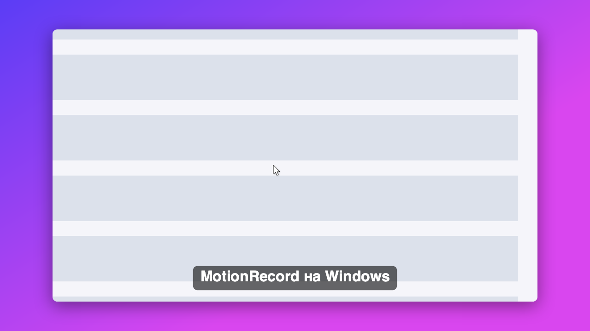

<div align="center">

<br>

# MotionRecord

**Запись экрана, после которой видео уже готово.**

Плавный курсор. Авто-зум по кликам. Монтаж на таймлайне. Экспорт в MP4.

<br>


<br>



<sub>Кадр, отрисованный движком MotionRecord: фон, скруглённый экран, зум, курсор, текст.</sub>

<br>

</div>

---

## Как это работает

**Курсор записывается отдельно.** Он не вшит в картинку, поэтому его можно сгладить, увеличить или заменить уже после записи.

**Клики решают, куда смотреть.** Камера сама приближается к месту клика и плавно возвращается назад.

**Монтаж без лишнего.** Разрез, удаление, скорость, ручной зум, текст. Всё на одном таймлайне.

---

## Видео

**[Как скачать и запустить за 27 секунд →](https://github.com/Zenka737/MotionRecord/blob/main/docs/tutorial.mp4)**

---

## Две версии

| | **macOS** | **Windows** |
|---|---|---|
| Папка | [`mac/`](mac) | [`windows/`](windows) |
| Стек | Swift, SwiftUI, ScreenCaptureKit | C#, .NET 8, WPF, SkiaSharp |
| Статус | полная версия | MVP |
| Запись | экран, камера, микрофон, клавиши | экран, курсор, клики |
| Монтаж | таймлайн, окна-вырезы, блюр, звук | таймлайн, зум, текст, скорость |

Обе версии пишут одинаковые `meta.json` и `project.json`, так что запись можно открыть на любой.

---

## macOS

```bash
cd mac
./scripts/build_app.sh
open build/MotionRecord.app
```

Нужен macOS 14+. При первом запуске разрешите запись экрана.

---

## Windows

Нужны Windows 10 (2004) или 11 и [.NET 8 SDK](https://dotnet.microsoft.com/download/dotnet/8.0).

```powershell
cd windows
.\build.ps1
.\fetch-ffmpeg.ps1
.\publish\MotionRecord.exe
```

Запись: **Ctrl + Shift + R**. Остановка: тем же сочетанием.

Подробная инструкция и список проверок: [`windows/README.md`](windows/README.md).

Готовый `.exe`: **Releases → MotionRecord-win-x64.zip** (распаковать и запустить `MotionRecord.exe`).
Сборка идёт автоматически: **Actions → windows-build → Artifacts**.

---

## Статус

Ядро Windows-версии (сглаживание курсора, камера, время, JSON) покрыто тестами и сверено с кодом macOS-версии. Окно, захват экрана и экспорт на Windows ещё проходят первую проверку, возможны ошибки.

---

<div align="center">
<sub>GPL-3.0 · сделано Zenka737</sub>
</div>
